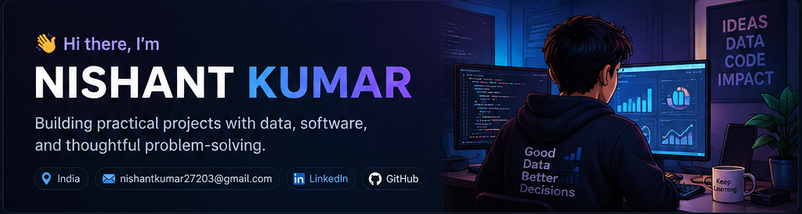
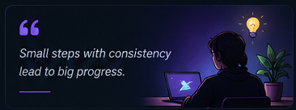

  

  

    
    
  

👤 About Me
<table>
  <tr>
    <td width="68%" valign="top">
      
I'm Nishant, a curious learner who enjoys working with data, building useful applications, and turning ideas into real projects. I like exploring new technologies, solving problems, and creating simple solutions that make data easier to understand.

      
This space is a collection of my projects, learning journey, and the tools I work with.

    </td>
    <td width="32%" valign="top">
      <h3>🚀 What I Enjoy</h3>
      
🔹 Explore new technologies 🔹 Build practical projects 🔹 Solve real-world problems 🔹 Keep learning and improving

    </td>
  </tr>
</table>

⚙️ Tech Stack

<strong>Programming & Data</strong>

  
  
  
  
  
  

<strong>Dashboards & Visualization</strong>

  
  
  
  
  

<strong>Web, APIs & Databases</strong>

  
  
  
  
  
  
  

<strong>Tools & Workflow</strong>

  
  
  
  

📊 GitHub Stats & Activity
<table>
  <tr>
    <td width="50%" valign="top">
      
    </td>
    <td width="50%" valign="top">
      
    </td>
  </tr>
</table>

  

🚀 Featured Projects
<table>
  <tr>
    <td width="33%" valign="top">
      
      <h3>📊 <a href="https://github.com/Nishant27203/commerce-pulse">Commerce Pulse</a></h3>
      
Sales analytics dashboard to explore business performance, track KPIs, and identify trends through interactive visualizations.

      
   

      <a href="https://github.com/Nishant27203/commerce-pulse">View repository →</a>
    </td>
    <td width="33%" valign="top">
      
      <h3>👥 <a href="https://github.com/Nishant27203/TeamPulse-Workforce-Insights">TeamPulse</a></h3>
      
Workforce insights dashboard to analyze workforce data with KPI visualizations, interactive filters, and downloadable reports.

      
  

      <a href="https://github.com/Nishant27203/TeamPulse-Workforce-Insights">View repository →</a> · <a href="https://teampulse-workforce-insights-9dyhc3kfvayqylzdtbqwsx.streamlit.app/">Live demo</a>
    </td>
    <td width="33%" valign="top">
      
      <h3>🌿 <a href="https://github.com/Nishant27203/plant-disease-detector">Plant Disease Detector</a></h3>
      
Image-classification application for identifying tomato leaf diseases using machine learning and image-processing approaches.

      
  

      <a href="https://github.com/Nishant27203/plant-disease-detector">View repository →</a> · <a href="https://plant-disease-detector-l3sm.onrender.com">Live demo</a>
    </td>
  </tr>
</table>

🔎 More Projects
- Job Skill Gap Analyzer — analyzes job descriptions, surfaces in-demand skills, and compares required skills with a candidate profile.
- Enterprise IT Help Desk & Ticket Management System — ticket tracking, SLA monitoring, dashboards, user management, and knowledge-base features.
🏆 Achievements & Mindset

  
  
  

<table>
  <tr>
    <td width="58%" valign="middle">
      <blockquote>
        <strong>“Small steps with consistency lead to big progress.”</strong> 
        Keep building. Keep learning. Keep improving.
      </blockquote>
    </td>
    <td width="42%" valign="middle">
      
    </td>
  </tr>
</table>

✨ Let's Connect
I'm always open to interesting discussions, new ideas, and opportunities to collaborate and learn.

  
  
  

  Thanks for visiting! 😊 
  <i>Curious by nature · Practical in approach · Always learning</i>

